<!--
  Generated by profile/build.py. Edit profile/content.py, then run:
    pip install -r profile/requirements.txt && python profile/build.py
-->

<picture><source media="(prefers-color-scheme: dark)" srcset="assets/hero-dark.svg"><source media="(prefers-color-scheme: light)" srcset="assets/hero-light.svg"></picture>

<a href="https://tony-github-io.vercel.app"><picture><source media="(prefers-color-scheme: dark)" srcset="assets/btn-portfolio-dark.svg"><source media="(prefers-color-scheme: light)" srcset="assets/btn-portfolio-light.svg"></picture></a><a href="https://tonylinktech.co.za"><picture><source media="(prefers-color-scheme: dark)" srcset="assets/btn-company-dark.svg"><source media="(prefers-color-scheme: light)" srcset="assets/btn-company-light.svg">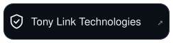</picture></a><a href="https://www.linkedin.com/in/tony-tabwa-7145b0140"><picture><source media="(prefers-color-scheme: dark)" srcset="assets/btn-linkedin-dark.svg"><source media="(prefers-color-scheme: light)" srcset="assets/btn-linkedin-light.svg"></picture></a><a href="mailto:tabwatony7@gmail.com"><picture><source media="(prefers-color-scheme: dark)" srcset="assets/btn-email-dark.svg"><source media="(prefers-color-scheme: light)" srcset="assets/btn-email-light.svg"></picture></a>

 

<picture><source media="(prefers-color-scheme: dark)" srcset="assets/h01-profile-dark.svg"><source media="(prefers-color-scheme: light)" srcset="assets/h01-profile-light.svg"></picture>

<picture><source media="(prefers-color-scheme: dark)" srcset="assets/profile-dark.svg"><source media="(prefers-color-scheme: light)" srcset="assets/profile-light.svg"></picture>

 

<picture><source media="(prefers-color-scheme: dark)" srcset="assets/h02-arsenal-dark.svg"><source media="(prefers-color-scheme: light)" srcset="assets/h02-arsenal-light.svg"></picture>

<picture><source media="(prefers-color-scheme: dark)" srcset="assets/arsenal-dark.svg"><source media="(prefers-color-scheme: light)" srcset="assets/arsenal-light.svg">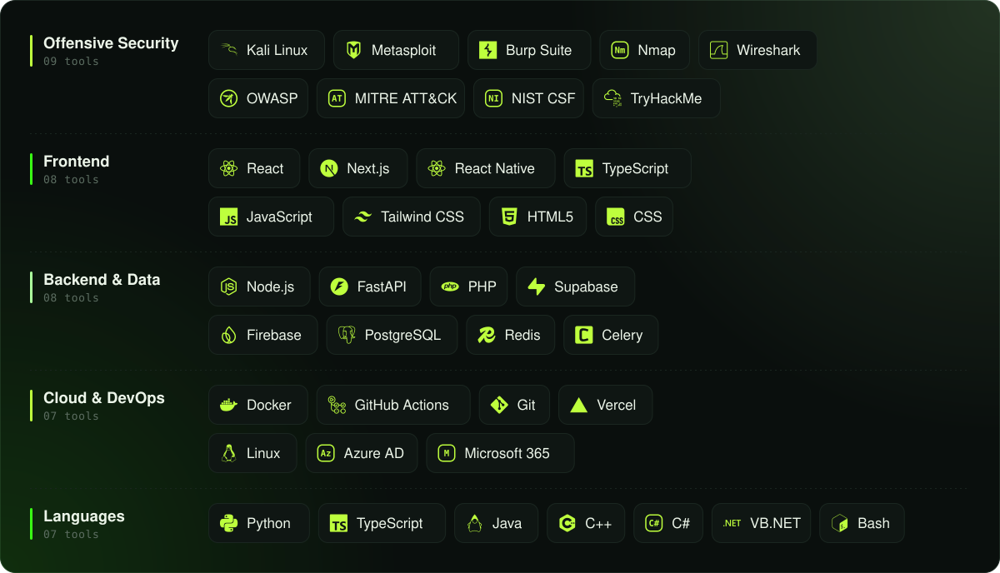</picture>

 

<picture><source media="(prefers-color-scheme: dark)" srcset="assets/h03-featured-work-dark.svg"><source media="(prefers-color-scheme: light)" srcset="assets/h03-featured-work-light.svg"></picture>

<a href="https://accrediq.co.za"><picture><source media="(prefers-color-scheme: dark)" srcset="assets/project-accrediq-dark.svg"><source media="(prefers-color-scheme: light)" srcset="assets/project-accrediq-light.svg"></picture></a><a href="https://github.com/ProlificTMontana/red_team_automation_toolkit"><picture><source media="(prefers-color-scheme: dark)" srcset="assets/project-red-team-toolkit-dark.svg"><source media="(prefers-color-scheme: light)" srcset="assets/project-red-team-toolkit-light.svg"></picture></a>

<a href="https://github.com/ProlificTMontana/OSINT-Automation-Tool"><picture><source media="(prefers-color-scheme: dark)" srcset="assets/project-osint-dark.svg"><source media="(prefers-color-scheme: light)" srcset="assets/project-osint-light.svg"></picture></a><a href="https://autoreserve-africa.com"><picture><source media="(prefers-color-scheme: dark)" srcset="assets/project-autoreserve-dark.svg"><source media="(prefers-color-scheme: light)" srcset="assets/project-autoreserve-light.svg"></picture></a>

 

<picture><source media="(prefers-color-scheme: dark)" srcset="assets/h04-experience-dark.svg"><source media="(prefers-color-scheme: light)" srcset="assets/h04-experience-light.svg"></picture>

<picture><source media="(prefers-color-scheme: dark)" srcset="assets/timeline-dark.svg"><source media="(prefers-color-scheme: light)" srcset="assets/timeline-light.svg"></picture>

<picture><source media="(prefers-color-scheme: dark)" srcset="assets/impact-dark.svg"><source media="(prefers-color-scheme: light)" srcset="assets/impact-light.svg">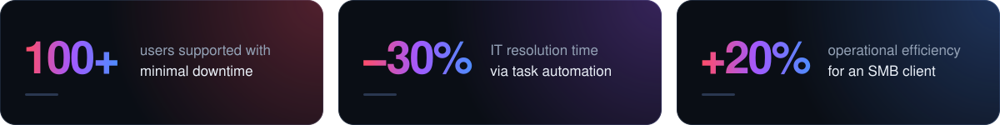</picture>

<b>Full experience breakdown</b>

 

**Full-Stack Engineer** · _current_
- Architecting and building SaaS compliance engines that turn regulatory requirements (accreditation scope, staff credentials, assessment, moderation and certification) into auditable, multi-tenant workflows with tenant isolation enforced at the database layer.
- Implemented CI/CD pipelines with Git for version control in secure web app deployments, streamlining development cycles and reducing downtime.
- Developed and deployed full-stack web applications for small businesses, integrating Microsoft 365 APIs to optimize workflows and enhance data security.

**Freelance Tech Admin & Web Developer**
- Administered Microsoft 365 environments for small businesses, optimizing workflows and security.
- Delivered remote IT support, resolving issues efficiently for diverse clients.
- Designed and deployed secure web applications using modern CI/CD pipelines and Git for version control.

**Red Team Intern**
- Conducted simulated cyber-attacks to identify and fortify system vulnerabilities.
- Performed network traffic analysis using tools like Wireshark to detect and patch security gaps.
- Collaborated with teams to develop and implement security remediation plans.

**I.T Support Intern**
- Provided first-line technical support to over 100 users, ensuring minimal downtime.
- Managed Microsoft 365 and Azure AD accounts, streamlining user access and security.
- Configured firewalls, implemented network segmentation, and enhanced Wi-Fi security protocols.

 

<picture><source media="(prefers-color-scheme: dark)" srcset="assets/h05-telemetry-dark.svg"><source media="(prefers-color-scheme: light)" srcset="assets/h05-telemetry-light.svg"></picture>

<a href="https://github.com/ProlificTMontana?tab=repositories"><picture><source media="(prefers-color-scheme: dark)" srcset="https://raw.githubusercontent.com/ProlificTMontana/ProlificTMontana/output/telemetry-dark.svg"><source media="(prefers-color-scheme: light)" srcset="https://raw.githubusercontent.com/ProlificTMontana/ProlificTMontana/output/telemetry-light.svg"></picture></a>

 

<picture><source media="(prefers-color-scheme: dark)" srcset="assets/h06-connect-dark.svg"><source media="(prefers-color-scheme: light)" srcset="assets/h06-connect-light.svg"></picture>

<picture><source media="(prefers-color-scheme: dark)" srcset="assets/footer-dark.svg"><source media="(prefers-color-scheme: light)" srcset="assets/footer-light.svg"></picture>

<a href="https://tony-github-io.vercel.app"><picture><source media="(prefers-color-scheme: dark)" srcset="assets/btn-portfolio-dark.svg"><source media="(prefers-color-scheme: light)" srcset="assets/btn-portfolio-light.svg"></picture></a><a href="https://tonylinktech.co.za"><picture><source media="(prefers-color-scheme: dark)" srcset="assets/btn-company-dark.svg"><source media="(prefers-color-scheme: light)" srcset="assets/btn-company-light.svg"></picture></a><a href="https://www.linkedin.com/in/tony-tabwa-7145b0140"><picture><source media="(prefers-color-scheme: dark)" srcset="assets/btn-linkedin-dark.svg"><source media="(prefers-color-scheme: light)" srcset="assets/btn-linkedin-light.svg"></picture></a><a href="mailto:tabwatony7@gmail.com"><picture><source media="(prefers-color-scheme: dark)" srcset="assets/btn-email-dark.svg"><source media="(prefers-color-scheme: light)" srcset="assets/btn-email-light.svg"></picture></a>

Designed in code: every visual is generated by <a href="profile/"><code>profile/</code></a> · live stats refresh daily via GitHub Actions

